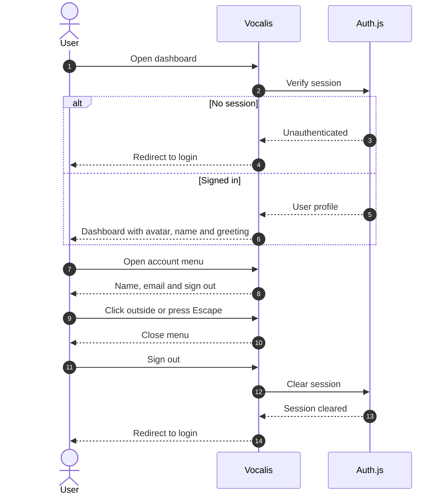

# Dashboard header user flow

The dashboard header shows the signed-in user's avatar, name and account menu.
The greeting reuses the same profile and shows only the first name.

## Sequence

## Behavior

- The header uses the authenticated user's name, email and avatar.
- The greeting uses only the first name.
- Missing names fall back to the email name; missing avatars fall back to initials.
- Sign-out clears the session and returns to the login page.
