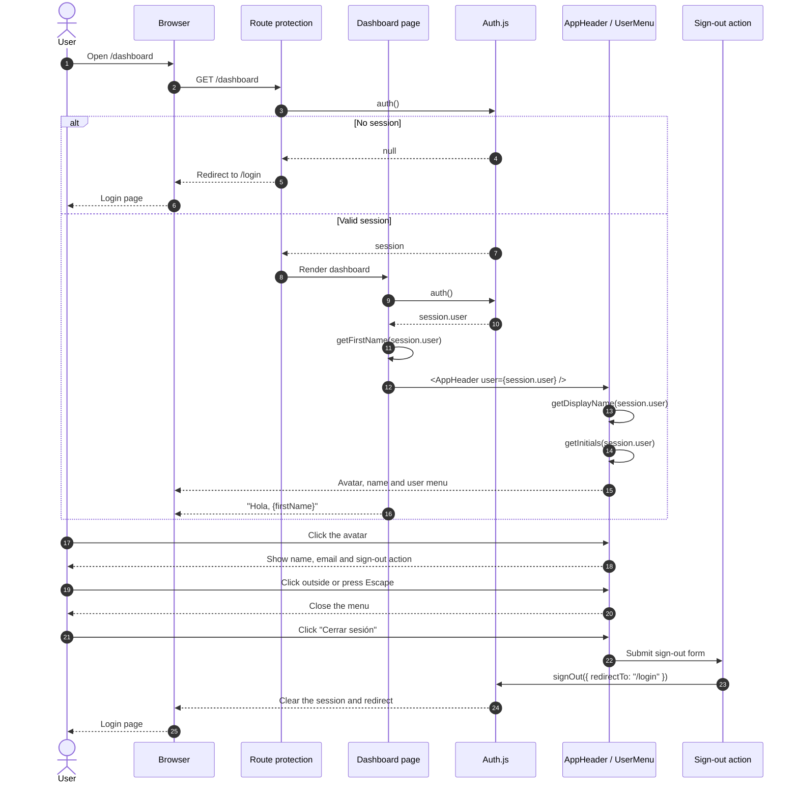

# Dashboard header user flow

This feature replaces the mocked current user in the dashboard header with the
authenticated Auth.js session user. The dashboard greeting uses the same user,
showing only the first name.

## Sequence

## Fallback rules

- `getDisplayName`: trimmed name, then the email local part, then `"Invitado"`.
- `getFirstName`: first word of the display name for the greeting.
- `getInitials`: initials derived from the name or email; apostrophes are treated
  as separators, so `"O'Connor"` becomes `"OC"`.
- `user.image` is rendered when present. The initials avatar is used otherwise.
- The user menu closes on an outside pointer event or `Escape`. `Escape` returns
  focus to the menu summary.
