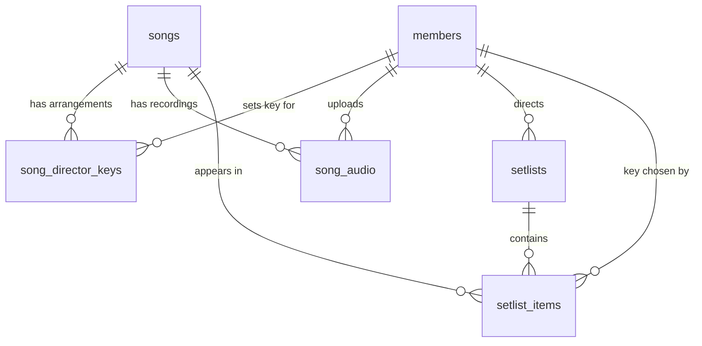

# Songs database schema plan

Status: implemented for schema, migrations, seed and read path. Audio uploads are
still pending.

## Goal

Move songs, their per-director keys, setlists and team data out of
`features/*/data` into a real database so the app reads the same source locally
and in production.

## Decisions

- **Cloudflare D1 + Drizzle ORM.** The app already deploys as a Worker through
  vinext, so D1 is the database that runs where the app runs. Drizzle gives
  typed queries and generated SQL migrations. No external service or extra
  credentials are needed beyond the Cloudflare account used for deploy.
- **Directors are members.** There is no separate `directors` table. The
  existing code already stores `directorId` values that point at team members,
  so a person exists once in `members` and songs/setlists reference it.
- **Readable text ids (slugs).** Songs keep their import ids
  (`que-se-llene-tu-casa`), which are already URL-safe. Members get a slug of
  their name (`orlando-paredes`). This keeps rows debuggable without a lookup.
- **Keys are stored as note + symbol + mode.** The current type only has note
  and symbol, but the import lost minor keys (`Re-` became `Re`). Adding `mode`
  now means future imports can preserve it. Imported rows default to `major`.
- **Unknown values stay unknown.** The import has a song without a key and many
  with `durationSeconds: 0`. Those columns are nullable/zeroable rather than
  filled with invented data.
- **Single team for now.** There is no `teams` table. Multi-tenancy would add a
  `team_id` to members and setlists plus a scope to every query; it is a
  deliberate later step, not part of this schema.
- **Rehearsals are not persisted.** The dashboard's rehearsal hint is not part
  of this schema. It stays as static UI data (or is removed) until it has a real
  source.
- **Audio files live in R2, metadata in D1.** D1 is a SQLite database and is the
  wrong place for binary files. A `song_audio` table stores the reference to an
  R2 object; the upload UI and the `AUDIO` bucket binding come later. Rows are
  included in the first schema so adding uploads does not require reshaping
  songs.

## Schema

All timestamps are Unix milliseconds (`integer`). All foreign keys use
`ON DELETE` behavior noted below.

### `members`

| Column        | Type | Notes                                            |
| ------------- | ---- | ------------------------------------------------ |
| `id`          | text | PK, slug (`ana`, `orlando-paredes`)              |
| `name`        | text | not null                                         |
| `initials`    | text | not null, derived on insert (`OP`)               |
| `role`        | text | `director` \| `musico` \| `corista`              |
| `role_label`  | text | display label (`Directora`, `Músico`)            |
| `tone`        | text | avatar tone, default `neutral`                   |
| `email`       | text | nullable, unique; future link to Auth.js user    |
| `created_at`  | int  | not null, default now                            |

The five directors found in `songs-import.json` become members with
`role = 'director'`: Orlando Paredes, Angelina Paredes, Eyleen Barroso, Alvaro
Olier and Mary. The existing mock team members are seeded alongside them.

### `songs`

| Column                | Type    | Notes                                             |
| --------------------- | ------- | ------------------------------------------------- |
| `id`                  | text    | PK, slug                                          |
| `title`               | text    | not null                                          |
| `artist`              | text    | not null, default `Desconocido`                   |
| `original_key_note`   | text    | nullable (import has a null original key)         |
| `original_key_symbol` | text    | nullable                                          |
| `original_key_mode`   | text    | `major` \| `minor`, default `major`               |
| `duration_seconds`    | int     | not null, default `0` where unknown               |
| `has_home_version`    | boolean | not null, default false                           |
| `created_at`          | int     | not null, default now                             |
| `updated_at`          | int     | not null, default now                             |

### `song_director_keys`

One row per director arrangement for a song. `context` is nullable because the
import does not carry it, while the mock data uses `acústico`/`banda`.

| Column        | Type | Notes                                          |
| ------------- | ---- | ---------------------------------------------- |
| `song_id`     | text | FK `songs.id`, cascade delete                  |
| `director_id` | text | FK `members.id`, restrict delete               |
| `key_note`    | text | not null                                       |
| `key_symbol`  | text | not null                                       |
| `key_mode`    | text | `major` \| `minor`, default `major`            |
| `context`     | text | nullable; `acústico` \| `banda`                |

Primary key: `(song_id, director_id)`. If a director later needs more than one
arrangement for a song, this becomes a surrogate id plus a
`(song_id, director_id, context)` unique key.

### `setlists`

| Column          | Type | Notes                                    |
| --------------- | ---- | ---------------------------------------- |
| `id`            | text | PK, slug (`domingo`)                     |
| `title`         | text | not null                                 |
| `service_label` | text | not null (`Domingo · 10:00`)             |
| `director_id`   | text | FK `members.id`, restrict delete         |
| `service_at`    | int  | nullable; exact service date when known  |
| `created_at`    | int  | not null, default now                    |

### `setlist_items`

| Column        | Type | Notes                                       |
| ------------- | ---- | ------------------------------------------- |
| `setlist_id`  | text | FK `setlists.id`, cascade delete            |
| `position`    | int  | 1-based order within the setlist            |
| `song_id`     | text | FK `songs.id`, restrict delete              |
| `director_id` | text | FK `members.id`, restrict delete            |
| `key_note`    | text | not null; key chosen for this service       |
| `key_symbol`  | text | not null                                    |
| `key_mode`    | text | `major` \| `minor`, default `major`         |

Primary key: `(setlist_id, position)`. The chosen key is copied onto the item,
not looked up from `song_director_keys`, so a setlist keeps the key it was
planned with even if the song's default arrangement changes.

### `song_audio`

Metadata for a recording attached to a song. Audio can be a home version, the
original reference track or any future recording of the song. The file itself
is stored in R2 under `storage_key`; the row records where it lives and what it
is.

| Column             | Type | Notes                                                  |
| ------------------ | ---- | ------------------------------------------------------ |
| `id`               | text | PK, generated id                                       |
| `song_id`          | text | FK `songs.id`, cascade delete                          |
| `kind`             | text | `home` \| `original` \| `reference`                    |
| `label`            | text | display label (`Versión de casa`, `Demo`)              |
| `storage_key`      | text | not null, unique; R2 object key                        |
| `mime_type`        | text | not null (`audio/mpeg`, `audio/mp4`, `audio/wav`)      |
| `size_bytes`       | int  | not null                                               |
| `duration_seconds` | int  | not null, default `0` where unknown                    |
| `uploaded_by`      | text | nullable FK `members.id`, set null on delete           |
| `created_at`       | int  | not null, default now                                  |

A home version is `kind = 'home'`. `songs.has_home_version` stays in the first
schema because it comes from the existing catalog, but once uploads exist the
flag can be derived with `EXISTS (... kind = 'home')` and dropped. Multiple
recordings of the same kind are allowed: a song can keep an old home version
next to a newer one.

## Relationships



## Indexes and constraints

- `members.email` unique where not null (SQLite allows multiple nulls).
- `songs.title` and `songs.artist` indexes for catalog search.
- `song_director_keys`: PK `(song_id, director_id)`, index on `director_id`.
- `setlists`: index on `director_id` and `service_at`.
- `setlist_items`: PK `(setlist_id, position)`, indexes on `song_id` and
  `director_id`.
- `song_audio`: unique `storage_key`, indexes on `song_id` and `uploaded_by`.
- `CHECK` constraints for the enum-like columns (`role`, `tone`, `context`,
  `key_mode`, `kind`) to catch bad writes in the database, not only in TS.

## Import mapping (`songs-import.json`)

The file has 128 songs and 127 warnings. The seed step should be explicit about
what it can and cannot recover:

| Import value                    | Stored as                                                    |
| ------------------------------- | ------------------------------------------------------------ |
| `song.id`                       | `songs.id` unchanged                                         |
| `song.originalKey` (null)       | null key columns                                             |
| `song.durationSeconds` (0)      | `0`; UI must treat `0` as unknown, not "0 min"               |
| `song.directorKeys[].directorId`| slugified `members.id`, member created if missing            |
| missing `artist`                | `Desconocido` (already normalized by the export)             |
| `Re-` minor key                 | `note = Re`, `mode = major`; the mode was lost in the export |
| `context` (absent)              | `NULL`                                                       |
| `warnings`                      | written to a generated `db/seed-report.json`, not persisted  |

Known data-quality follow-ups are kept in that report rather than in the
database: missing artists, missing keys, lost minor modes and zero durations.

## Local development and migrations

Today `npm run dev` runs Vite through the Cloudflare plugin, so the app runs in
workerd and D1 is emulated through Miniflare (persisted under
`.cloudflare/state`). `npm run dev:next` remains as a UI-only escape hatch.

Binding in `cloudflare.config.ts`:

```ts
env: {
  ASSETS: bindings.assets(),
  IMAGES: bindings.images(),
  DB: bindings.d1({ name: "vocalis" }),
}
```

Production binding needs the database UUID. The config reads
`D1_DATABASE_ID` and adds it to the binding when present:

```ts
const databaseId = process.env.D1_DATABASE_ID;
const database = databaseId
  ? { name: "vocalis", id: databaseId }
  : { name: "vocalis" };
```

When audio uploads land, add an R2 bucket alongside it:

```ts
DB: bindings.d1({ name: "vocalis" }),
AUDIO: bindings.r2({ name: "vocalis-audio" }),
```

The bucket stays out of the first implementation; only the `song_audio` table
and its queries need to exist for the schema to be ready.

Drizzle configuration (`drizzle.config.ts`): `dialect: "sqlite"`,
`schema: "./db/schema.ts"`, `out: "./drizzle"`. `drizzle-kit generate` writes
plain SQL, and the `cf` CLI applies it remotely (it understands Drizzle's
layout):

```bash
npm run db:generate   # drizzle-kit generate
npm run db:local      # apply migrations + seed to the running local D1
npm run db:migrate    # apply migrations to the remote D1 (D1_DATABASE_ID)
```

Local setup does not need a D1 UUID: `db/local.ts` uses the Cloudflare Vite
plugin's local explorer to find the `DB` binding, applies unapplied migrations,
records them in `d1_migrations`, and runs the seed.

`db/index.ts` creates the Drizzle client lazily from `env.DB`, so importing the
schema never requires a binding and a missing binding fails with a clear error.

## Seed strategy

`db/seed/build.ts` is a Node script (type-stripped by Node 26) that:

1. Reads `songs-import.json` plus the team and default setlist fixtures
   embedded in the script.
2. Normalizes director names to member slugs and derives initials.
3. Emits idempotent `INSERT ... ON CONFLICT DO NOTHING` SQL parts to
   `db/seed-data/` (each part stays under D1's 100 KB SQL statement limit).
4. Emits `db/seed-report.json` with the import warnings.

The default setlist from the current mock data is seeded so the dashboard keeps
working. Rehearsal data is not seeded; that card stays static or is removed.

Apply with:

```bash
npm run db:seed:generate
npm run db:local            # local: migrations + seed
npm run db:seed             # remote: seed only (D1_DATABASE_ID)
```

Re-running is safe: every insert uses `ON CONFLICT DO NOTHING`, so existing
members, songs, director keys and setlist items are left untouched. Rows added
through the app are not overwritten by a later seed.

## Implemented changes

1. `db/schema.ts`, `db/index.ts`, `drizzle.config.ts`, generated `drizzle/`.
2. `db/seed/build.ts`, generated `db/seed-data/*.sql` and report.
3. Query modules per feature (`features/canciones/queries.ts`,
   `features/setlists/queries.ts`, `features/equipo/queries.ts`), including
   `getSongAudio()` even though uploads do not exist yet.
4. Dashboard and login read `getHomeData()` from those queries instead of
   feature mock data. The rehearsal card keeps its static content.
5. The mock data files were removed; their fixtures now live in
   `db/seed/build.ts`.
6. Types were updated where the DB is more permissive than the mocks:
   `originalKey` is nullable, keys carry an optional `mode`, and a setlist with
   no known duration renders as "Sin duración" instead of "0 min".
7. README documents the stack, database workflow and scripts.
8. Audio uploads remain a follow-up: R2 binding, upload route, playback
   component and signed/public access policy.

## Open questions

- **Minor keys:** confirm the UI will surface major/minor. The export already
  lost the data, so imported songs would need manual review.
- **Multi-team:** confirm this stays a single-team app for now.
- **Auth users:** `members.email` is the hook for linking a signed-in user to a
  team member. Auth.js users still live only in the JWT, so linking needs a
  decision later.
- **Audio access:** are recordings public to the team, or should R2 objects be
  served through signed URLs? Also confirm accepted formats and size limits.
- **Home versions:** once audio exists, decide whether `has_home_version` is
  derived from `song_audio` or replaced by a richer `song_versions` table.
